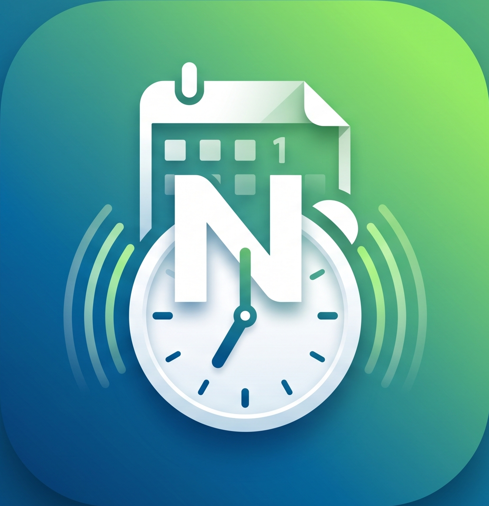
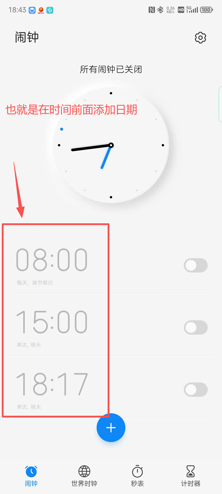
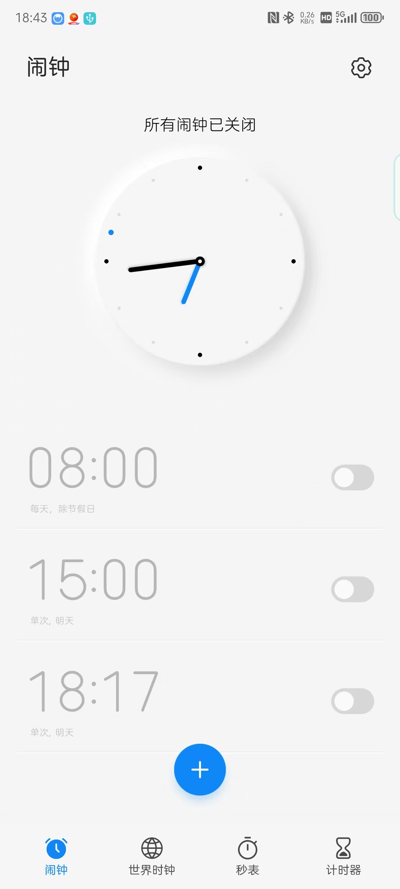
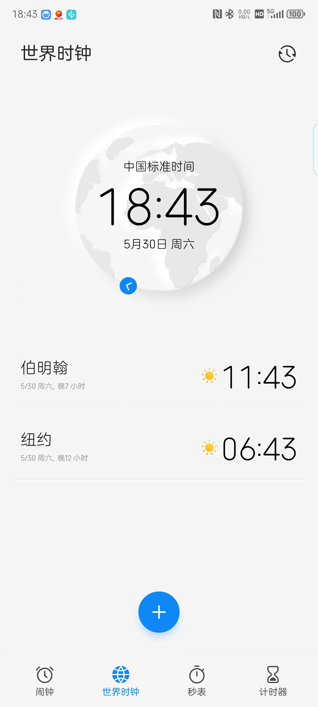
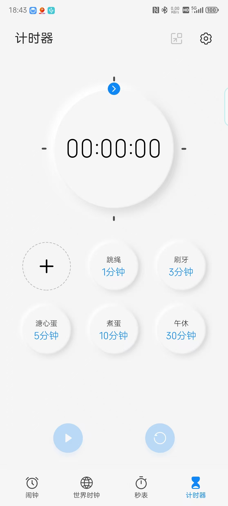
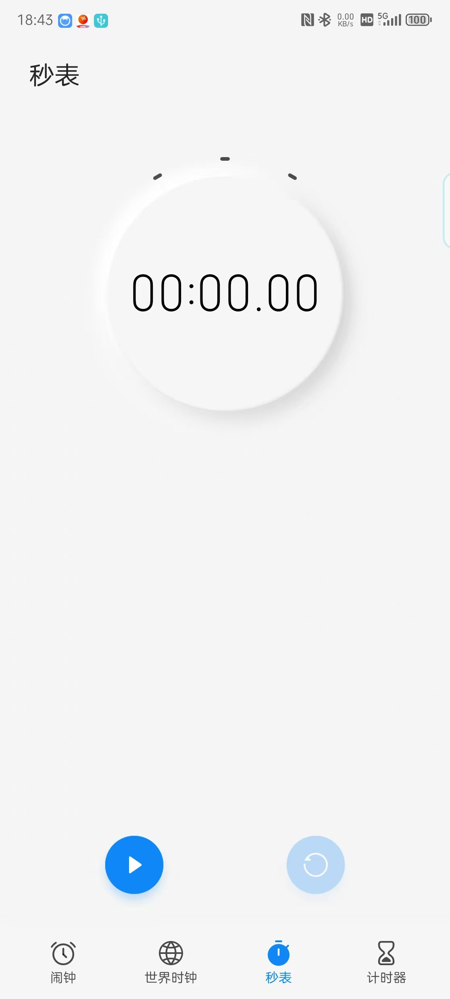
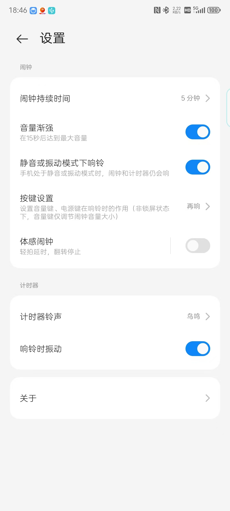

# 日历闹钟 Nexus (Calendar Alarm Nexus)

<div align="center">
  
</div>

日历闹钟 Nexus 是一款专为 Android 平台打造的系统级闹钟与日历日程管理应用。本作致力于提供媲美甚至超越 Android 原生系统闹钟的流畅体验，同时深度整合日历视图，让时间管理与日程规划完美融合。

应用名称: 日历闹钟Nexus

版本: 1.0.0

应用包名: com.alarm.plus.nexus

最低支持版本: Android 8.0 (API Level 26)

目标版本: Android 14 (API Level 34)

✨ 核心功能 (Core Features)

1. 基础闹钟 (Standard Alarm)

多闹钟管理: 支持添加、编辑、删除和快速启用/禁用多个闹钟。

自定义重复: 支持按周（单休、双休、自定义工作日）、按月、按年设置重复提醒。

日期显示强化: 结合日历特性，在闹钟时间前显式添加具体日期与秒数显示（格式精确到：年月日 时分秒，例如 2026年05月30日 08:00:00），让时间管理更直观精准。

铃声与震动: 支持系统铃声选择、本地音乐导入以及自定义震动模式。

贪睡模式 (Snooze): 可自定义贪睡间隔时间与最大贪睡次数。

标签与备注: 为每个闹钟添加自定义文本标签。

2. 日历视图 (Calendar Integration)

月/周视图切换: 直观查看当月或当周的所有预设闹钟与日程。

特定日期响铃: 突破传统“按周重复”的限制，支持在日历上选中特定日期（如法定节假日调休）设置专属闹钟。

3. 系统级唤醒 (System Integration)

精准定时: 使用系统级 AlarmManager 和 USE_EXACT_ALARM，确保在设备休眠或后台限制下依然精准响铃。

开机自启重启: 监听设备重启广播，自动恢复所有设定的闹钟计划。

全屏响铃通知: 锁屏状态下弹出全屏响铃界面，解锁状态下弹出高优先级浮动通知。

4. 综合时钟功能 (Comprehensive Clock Features)

除了核心闹钟与日历外，应用还集成了全面的时间管理工具：

- **计时器 (Timer)**: 预设与自定义倒计时，支持多种场景应用。
- **秒表 (Stopwatch)**: 高精度计次，满足运动、专注等计时需求。
- **世界时钟 (World Clock)**: 添加并查看全球多地时区时间。
- **设置 (Settings)**: 应用个性化配置与功能开关。
- **关于 (About)**: 查看应用版本信息与开发更新状态。

### 📱 界面预览 (UI Screenshots)

| 闹钟与日历 | 闹钟详情 | 世界时钟 |
| :---: | :---: | :---: |
|  |  |  |

| 计时器 | 秒表 | 系统设置 |
| :---: | :---: | :---: |
|  |  |  |

🛠️ 技术选型 (Tech Stack)

本项目采用现代 Android 开发标准构建：

编程语言: Kotlin (推荐) / Java

架构模式: MVVM (Model-View-ViewModel) + Repository Pattern

UI 框架: Jetpack Compose (或原生 XML 布局)

数据库: Room Persistence Library (用于持久化闹钟数据配置)

核心组件:

AlarmManager & PendingIntent: 处理核心定时逻辑。

BroadcastReceiver: 接收系统时间变化、时区变化、开机广播。

Service / Foreground Service: 播放铃声、控制震动及保持后台活跃。

NotificationCompat: 构建通知栏控制器。

📂 项目结构 (Project Structure)

com.alarm.plus.nexus
│
├── ui/                 # 界面层 (Activity, Fragment, Compose UI)
│   ├── main/           # 主界面 (闹钟列表, 日历视图)
│   ├── edit/           # 闹钟编辑/创建界面
│   └── ring/           # 响铃呼叫界面 (锁屏弹窗)
│
├── viewmodel/          # 视图模型层 (处理 UI 逻辑与数据状态)
│
├── data/               # 数据层
│   ├── local/          # Room 数据库实体 (AlarmEntity), DAO
│   └── repository/     # 闹钟数据仓库
│
├── core/               # 核心定时服务
│   ├── receiver/       # 广播接收器 (AlarmReceiver, BootReceiver)
│   ├── service/        # 前台响铃服务 (RingtoneService)
│   └── manager/        # 闹钟系统调度管理器 (AlarmScheduler)
│
└── utils/              # 工具类 (时间格式化, 权限检测, 震动控制等)


🔒 权限清单 (Permissions Required)

为了确保闹钟功能的正常与精准运行，应用需要在 AndroidManifest.xml 中声明以下权限：

<!-- 设置核心闹钟 -->
<uses-permission android:name="com.android.alarm.permission.SET_ALARM" />
<!-- 精准闹钟权限 (Android 12+) -->
<uses-permission android:name="android.permission.SCHEDULE_EXACT_ALARM" />
<uses-permission android:name="android.permission.USE_EXACT_ALARM" />

<!-- 锁屏显示与唤醒屏幕 -->
<uses-permission android:name="android.permission.WAKE_LOCK" />
<uses-permission android:name="android.permission.DISABLE_KEYGUARD" />
<uses-permission android:name="android.permission.SYSTEM_ALERT_WINDOW" />

<!-- 硬件控制 (震动) -->
<uses-permission android:name="android.permission.VIBRATE" />

<!-- 监听设备重启以恢复闹钟 -->
<uses-permission android:name="android.permission.RECEIVE_BOOT_COMPLETED" />

<!-- 前台服务与通知 (Android 13+) -->
<uses-permission android:name="android.permission.FOREGROUND_SERVICE" />
<uses-permission android:name="android.permission.POST_NOTIFICATIONS" />


🚀 快速开始 (Getting Started)

克隆本仓库到本地环境：

```bash
git clone https://github.com/lzf577/CalendarAlarmNexus.git
```


使用 Android Studio (推荐最新版本) 打开项目。

等待 Gradle 同步完成。

连接 Android 设备或启动模拟器。

点击 Run -> app 或按 Shift + F10 编译并运行项目。

📋 开发计划 (Todo List)

[ ] 完成基础数据库搭建 (Room)。

[ ] 实现 AlarmManager 核心调度器。

[ ] 开发主界面列表 UI 与日历视图 UI。

[ ] 编写锁屏/后台响铃前台服务。

[ ] 适配 Android 12+ 精准闹钟权限策略限制。

[ ] 适配 Android 14 全屏意图 (Full-Screen Intent) 限制。

[ ] (可选) 接入云端同步功能。

📄 许可证 (License)

[在此处添加您的开源/商业许可证信息，例如 MIT License 或 Apache License 2.0]